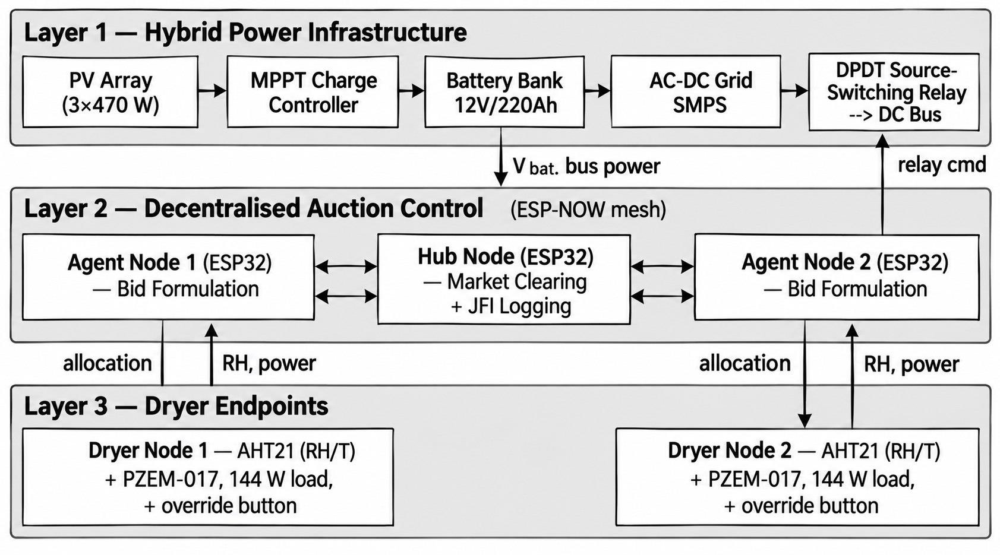
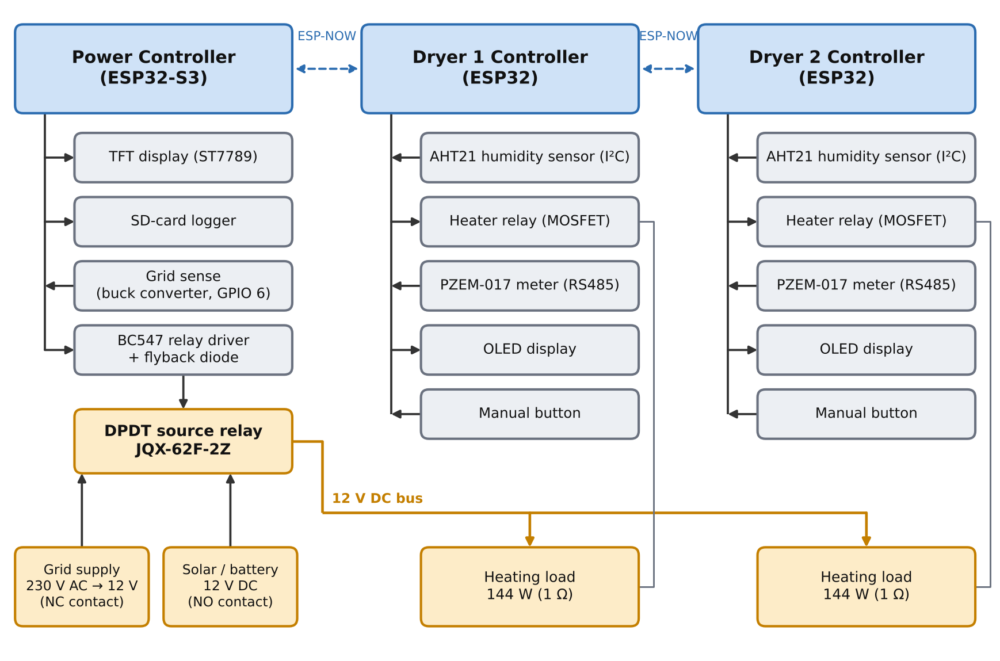
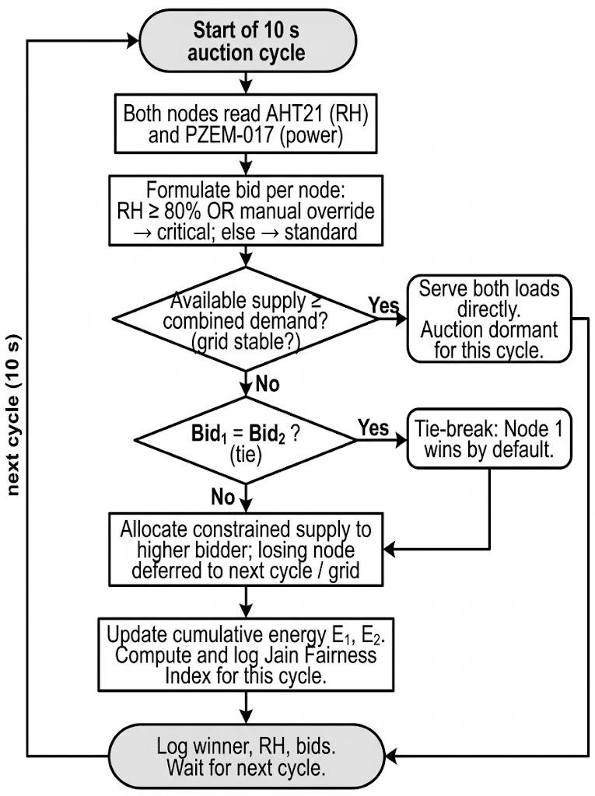
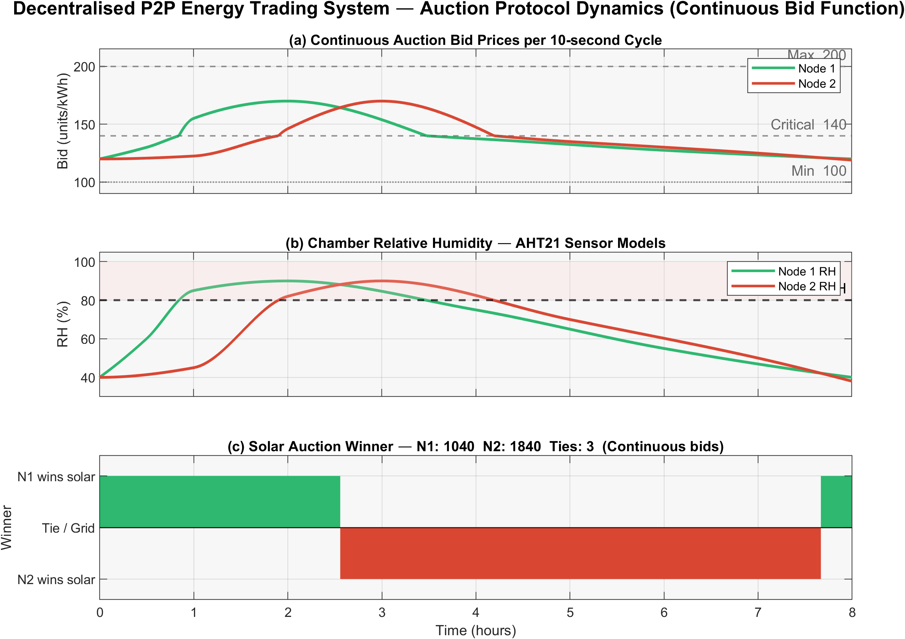
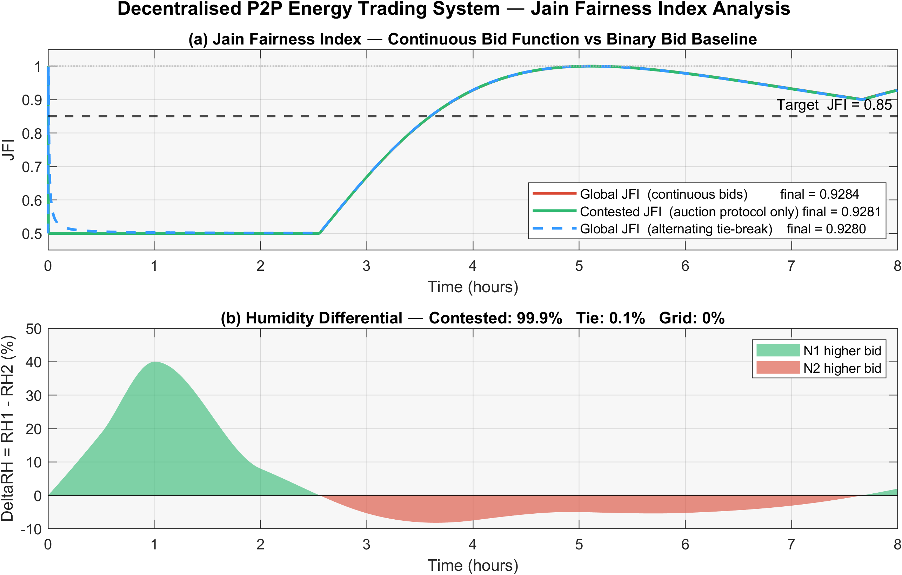
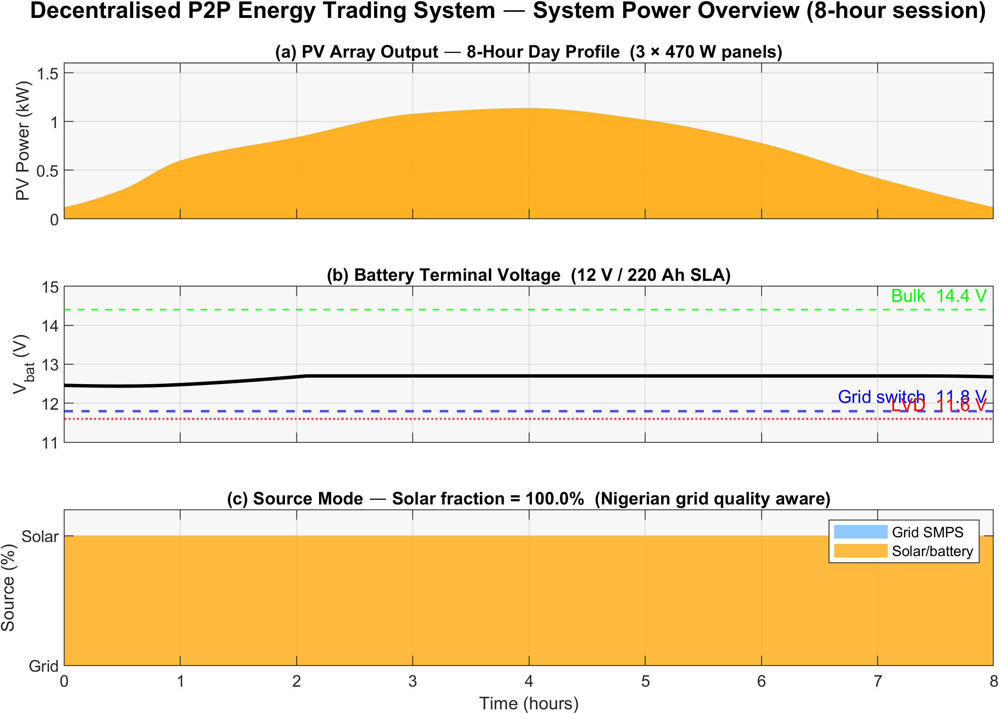
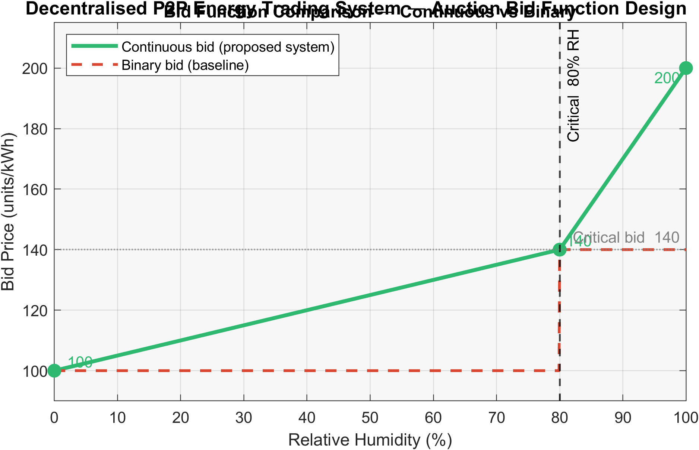
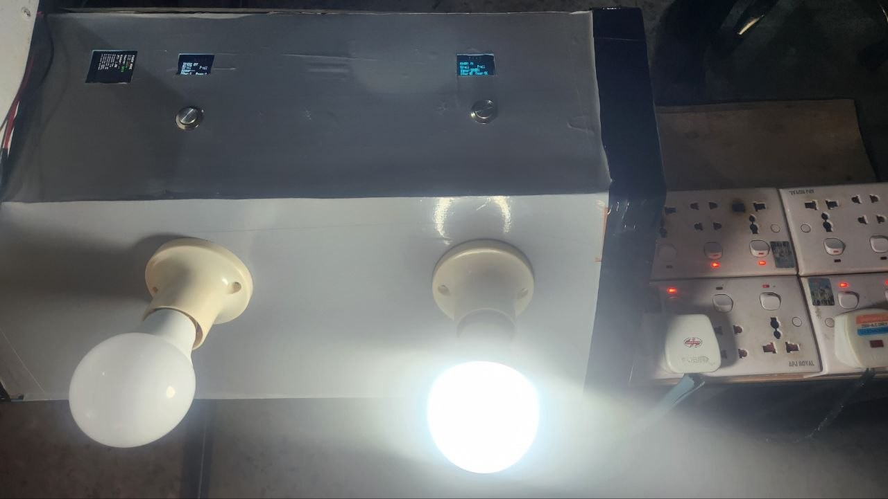
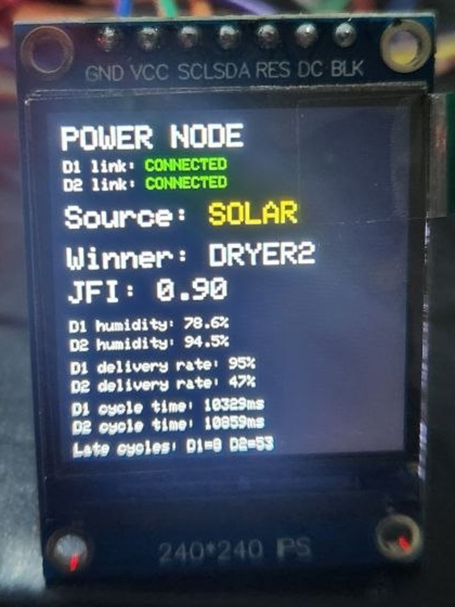
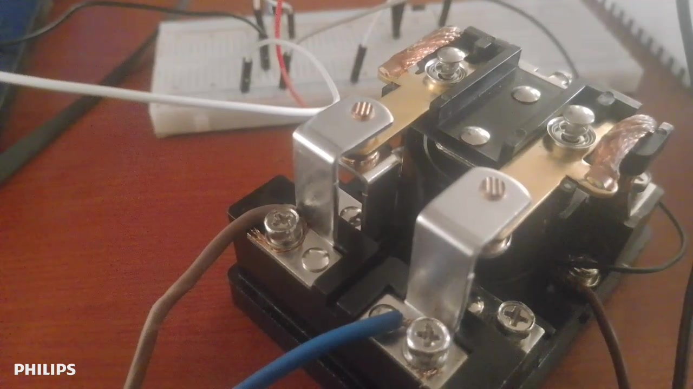

# DP2P: Decentralised Auction-Based Peer-to-Peer Energy Management

**Fair, offline sharing of scarce power, demonstrated on a hybrid solar-grid agricultural dryer microgrid built on ESP32 controllers.**

Final-year project, Department of Mechatronics Engineering, Federal University of Technology, Minna, Nigeria
**Author:** Muhammad Tariq Abdulraheem · **Supervisor:** Engr. Dr. J. A. Bala

---

## The problem

When there isn't enough power to run every load at once, someone has to decide who gets it. In Nigeria this happens every day: the national grid collapsed 12 times in 2024 alone, and shared facilities fall back on whoever arrives first or argues loudest. Smart energy-sharing systems exist, but they depend on internet connectivity, cloud servers or blockchain ledgers that rural communities cannot rely on.

## The idea

Each load is an ESP32 node that **bids for power using a measured need signal**. Every node hears every bid over **ESP-NOW** (no router, no internet) and applies the same rule, so all nodes reach the same decision without a central controller. A DPDT relay switches the shared bus between grid and solar, and the relay rests on grid if the controller fails.

**Agricultural dryers are the test case.** Each dryer bids its chamber humidity, so the wettest produce is dried first. The same mechanism applies to any community sharing limited energy (a clinic, school, water pump, homes and places of worship) by giving each node a priority weight and a need signal. The work extends the author's earlier peer-reviewed platform for residential energy sharing:

> M. T. Abdulraheem *et al.*, "A Dual-System Approach to Enhancing Renewable Energy Capture and Peer-to-Peer Distribution for Residential Communities in Nigeria," *Applied Mechanics and Materials*, vol. 933, pp. 143–154, 2026.

## Architecture

<p align="center"></p>

| Layer | Role | Main components |
|---|---|---|
| 1 · Power | Produce a 12 V DC bus from grid or solar/battery | 240 V AC → 12 V 40 A SMPS (NC contact) · 3 × 470 W PV, 150 A MPPT, 12 V 220 Ah battery (NO contact) · JQX-62F DPDT relay with BC547 driver |
| 2 · Control | Decide every 10 s which load gets power | ESP32-S3 power node (TFT, SD logger, grid sense) + one ESP32 per dryer, ESP-NOW broadcast |
| 3 · Loads | Measure need and energy, switch own load | AHT21 humidity sensor, PZEM-017 DC meter (RS485), 144 W heating load via relay |

<p align="center"></p>

### Decision rule (every node, every round)

Continuous bid as a function of relative humidity (simulation):

```
b(RH) = 100 + 40·RH/0.80                 for RH < 80 %
b(RH) = 140 + 60·(RH − 0.80)/0.20        for RH ≥ 80 %
winner = node with the highest bid
```

Fairness is tracked with Jain's index, `J = (E1 + E2)² / (2·(E1² + E2²))`, which runs from 0.5 (one node gets everything) to 1.0 (equal share).

<p align="center"></p>

## Results

### Simulation (MATLAB/Simulink R2024b, 8-hour session, 2,880 rounds)

| Metric | Result | Target |
|---|---|---|
| Jain fairness index (overall / contested rounds / alternating tie-break) | **0.9284 / 0.9281 / 0.9280** | ≥ 0.85 |
| Solar energy fraction | **100 %** | ≥ 65 % |
| Rounds won, Node 1 / Node 2 / ties | 1,040 / 1,840 / 3 | — |
| Same session with a two-level (100 / 140) bid | J = 0.5975, 2,242 ties | — |

The continuous bid function is what makes the allocation fair. With a simple two-level bid, most rounds tie and the tie-break rule decides the outcome.

<p align="center">


</p>
<p align="center">


</p>

### Hardware prototype (bench)

| Reading (power-node display) | Run A | Run B |
|---|---|---|
| Both dryer nodes linked | yes | yes |
| Humidity D1 / D2 | 78.6 % / 94.5 % | 81.6 % / 83.5 % |
| Winner (all three boards agree) | Dryer 2 | Dryer 2 |
| Jain index (rounds won) | **0.90** | 0.50 |
| Round time D1 / D2 | 10.33 s / 10.86 s | 10.35 s / 10.83 s |

On the bench, a regulated supply stands in for the PV array and battery, and 12 V bulbs stand in for the heaters.

<p align="center">



</p>

A full write-up is in [`docs/Project_Summary.pdf`](docs/Project_Summary.pdf).

## Running the simulation

Requires **MATLAB R2024b** with Simulink. No Simscape is needed.

```matlab
cd matlab
setup_paths                       % add project folders to the path
init_microgrid                    % load parameters into the workspace
out = sim('p2p_microgrid');       % run the 8-hour closed-loop model
plot_final_figures(out)           % reproduce Figures 1–5 and the KPI numbers
```

Further analysis:

```matlab
run_layer1_scenarios   % solar-only, grid-only and weak-grid scenarios (Fig 6)
run_scenario_tests     % five protocol test cases through the Simulink model
jfi_contested          % overall vs contested-round fairness, tie-break comparison
```

The fairness and solar-fraction figures are computed by `plot_final_figures.m`, using a cycle-by-cycle session model that applies the same rules as the Simulink `Auction_Engine` block. The model files in `matlab/model/` are the finished versions, so the build scripts are only needed to regenerate the model from scratch.

## Repository layout

```
docs/                    Project summary (PDF)
figures/
  architecture/          Three-layer diagram, hardware block diagram, auction flowchart
  simulation/            Figures 1–5 from the Simulink study
  prototype/             Photos of the bench prototype
matlab/
  init_microgrid.m       All system parameters (PV, battery, grid, loads, auction)
  setup_paths.m          Adds project folders to the MATLAB path
  model/                 p2p_microgrid.slx (top level) and its three subsystems
                         ss1_power_plant · ss2_auction_ctrl · ss3_dryer_loads
  build/                 Scripts that generate the model, in this order:
                         build_ss3 → build_ss1 → build_ss2 → fix_algebraic_loop →
                         build_grid_acdc → add_grid_quality → update_auction_continuous
  analysis/              Figures, scenario tests and fairness analysis
  prototyping/           Step-by-step development of the auction, fairness and battery logic
```

## Beyond dryers

Each node's bid can combine a community-agreed **priority weight** with a **measured need**. For example, a clinic's weight of 1.0 can be multiplied by a need signal such as its vaccine-fridge temperature, while a school's lower weight is multiplied by whether classes are in session. Critical services are then protected first when supply is short, and Jain's index stops lower-priority users from being starved over the day. Because no node depends on a central server or the internet, a community's mini-grid keeps sharing its own solar power when the national grid fails.

## Status and next steps

- [x] Full-scale design and 8-hour Simulink study
- [x] Three-node ESP32 prototype: offline consensus, source switching, live fairness display
- [ ] Full-power trials with 144 W loads and real produce
- [ ] Energy-gain measurement against a fixed time-share schedule
- [ ] Tie-break rule and offline-winner reset in firmware
- [ ] Community pilot with mixed loads (clinic, school, homes)

The project is being developed into a product, **AutaDry**.

## Citation

If you use this work, please cite the project summary or contact the author.
